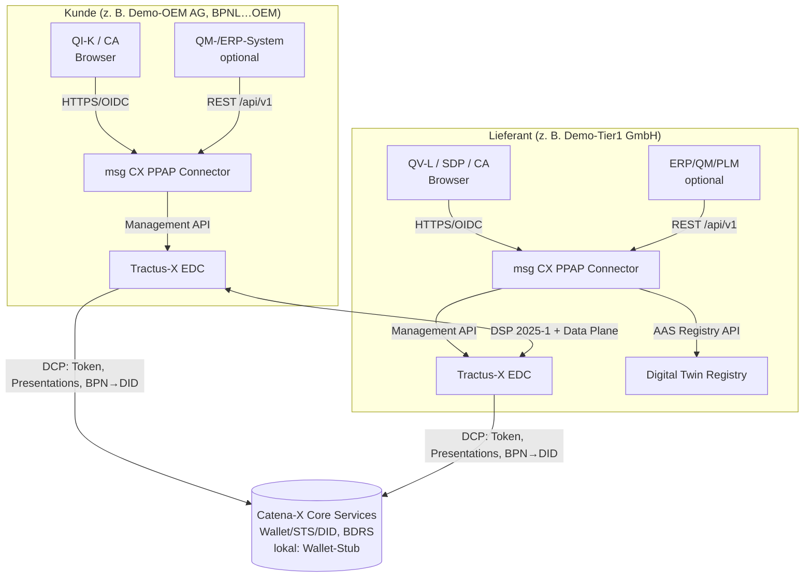
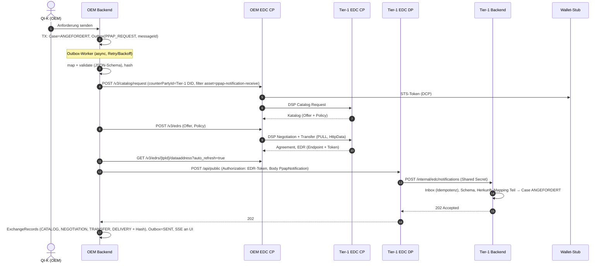
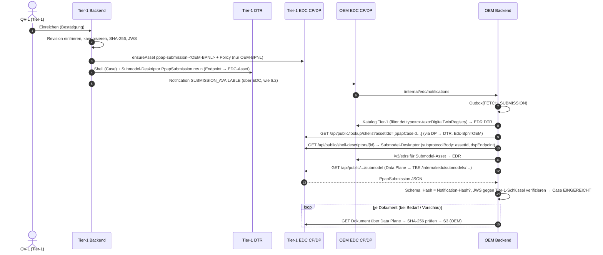
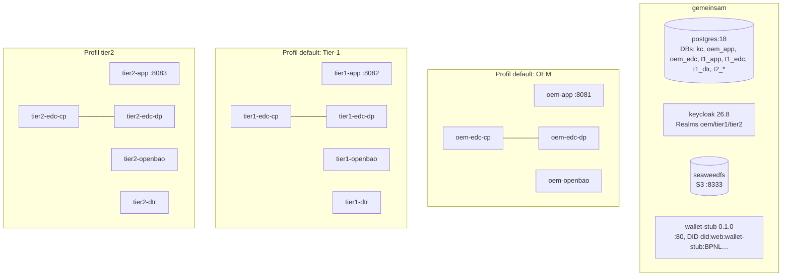

# Architektur – msg CX PPAP Connector (arc42-light)

Stand: Phase 0 – **Entwurf zur Freigabe**. Versionen: [versions.md](versions.md), [tractusx-versions.md](tractusx-versions.md). Entscheidungen: [adr/](adr/README.md).

## 1. Einführung und Ziele

Der **msg CX PPAP Connector** ermöglicht den strukturierten, digitalen Austausch von PPAP/PPF-Daten (Anforderung, Paket, Entscheidung) zwischen Kunden und Lieferanten über Catena-X (Tractus-X EDC, Dataspace Protocol). Er ist
- **Connector** für größere Unternehmen (REST-API zur Anbindung von ERP/QM/PLM → „Catena-X ready“) und
- **vollständige Anwendung** für kleine Zulieferer (Tier-2…5) mit UI für Stammdaten, Excel-Upload, PPF-Erfassung und Versand.

Scope: Datenaustausch und Stammdaten – keine Bemusterungs-Fachlogik (siehe Prompt §14).

### Qualitätsziele (priorisiert)

| # | Qualitätsziel | Szenario |
|---|---|---|
| Q1 | **Datensouveränität / Sicherheit** | Kein Datum verlässt einen Teilnehmer außer über einen EDC-Vertrag; jede Payload hash- und (für Einreichung/Entscheidung) signaturgesichert. |
| Q2 | **Änderbarkeit (Standard-Evolution)** | Ein neues Catena-X-Aspektmodell der Expert Group wird durch neuen Mapper + Schemas eingeführt, ohne Domänenänderung (≤ 1 Sprint). |
| Q3 | **Interoperabilität / EDC-Agnostik** | Wechsel auf einen extern betriebenen EDC nur per Konfiguration (+ ggf. Adapter-Flavor). |
| Q4 | **Bedienbarkeit** | Ein Tier-2-QV ohne Catena-X-Kenntnisse reicht ein PPF-Paket per Excel-Upload in < 10 min ein. |
| Q5 | **Zuverlässigkeit** | Ausfall eines Partner-EDC führt nicht zu Datenverlust; Zustellung wird automatisch nachgeholt (Outbox), Empfang ist idempotent. |
| Q6 | **Nachvollziehbarkeit** | Jeder Schritt (fachlich + technisch) im Audit-Trail inkl. Transfer-ID und Hash. |

## 2. Randbedingungen

- Java 25 (LTS), Spring Boot 4.x, PostgreSQL + Flyway, S3-kompatibler Object Storage, Keycloak (OIDC), REST `/api/v1` mit OpenAPI.
- Datenaustausch ausschließlich über **Eclipse Tractus-X EDC** (DSP 2025-1); Catena-X-Policies nach CX-0152; Identität über DCP (lokal: Wallet-Stub).
- Kommerzielles Closed-Source-Produkt → nur permissive Lizenzen in der Anwendung (ASSUMPTIONS A-31).
- Lauffähig per `docker compose` auf einem 32-GB-Laptop; 12-Factor-Konfiguration; kein Helm im Prototyp.
- Doku Deutsch, Code Englisch, UI DE/EN.

## 3. Kontextabgrenzung



| Nachbar | Schnittstelle | Inhalt |
|---|---|---|
| Benutzer | Web-UI (SPA), OIDC | alle Use Cases |
| ERP/QM/PLM des Kunden | REST `/api/v1` (OAuth2 Client Credentials) | Stammdaten-Upsert, Vorgänge, Einreichung, Entscheidung, Webhooks (später) |
| Eigener EDC | Management API v3 (API-Key) ↔ HttpData-Callbacks (Shared Secret) | Provisionierung, Katalog, Negotiation, EDR; Notification-Empfang, Submodel-/Dokumentabruf |
| Eigene DTR (Lieferant) | AAS Registry API 3.x (OAuth2) | Shells/Submodel-Deskriptoren der Freigabevorgänge |
| Partner | **nur** über EDC (DSP + Data Plane) | `PpapNotification`, `PpapSubmission`, Dokumente |
| Catena-X Core Services | via EDC (DCP) | Identität, Membership Credential, BPN-DID-Auflösung |

## 4. Lösungsstrategie

| Ziel | Ansatz |
|---|---|
| Q1 Souveränität | Instanz je Teilnehmer; Austausch nur über Port `DataspaceConnector`; Access-Policy je Partner-BPNL; Hash + JWS (ADR-0001, -0004, -0008) |
| Q2 Standard-Evolution | Eigene SAMM-Modelle v0.1.0 + versionierte Mapper im Modul `semantics`; Wiederverwendung Catena-X-/VDA-231-Schemas (ADR-0003) |
| Q3 EDC-Agnostik | Port/Adapter, deklarative Reconciliation der EDC-Ressourcen (ADR-0001) |
| Q4 Bedienbarkeit | React/shadcn-UI, Wizards, Excel-Formblatt-Import, Live-Updates (ADR-0005) |
| Q5 Zuverlässigkeit | Transactional Outbox, Inbox-Idempotenz, EDR-Cache mit Refresh, Retry/Backoff |
| Q6 Nachvollziehbarkeit | `ExchangeRecord` je technischem Schritt, append-only Audit mit Hash-Kette, Korrelations-ID end-to-end |
| Architekturstil | Modularer Monolith (Spring Modulith), innen hexagonal; Module kommunizieren über persistente Domain Events (ADR-0006) |

## 5. Bausteinsicht

### 5.1 Container (je Teilnehmer)

```mermaid
flowchart LR
  subgraph P["Teilnehmer-Instanz (z. B. tier1)"]
    UI[Web-UI<br/>React SPA<br/>(vom Backend ausgeliefert)]
    BE[Connector-Backend<br/>Spring Boot 4 / Java 25]
    DB[(PostgreSQL<br/>DB ppap_tier1)]
    S3[(Object Storage<br/>Bucket tier1)]
    CP[EDC Control Plane]
    DP[EDC Data Plane]
    V[(Secret Store<br/>OpenBao)]
    DTR[Digital Twin Registry<br/>nur Lieferanten]
  end
  KC[Keycloak<br/>Realm tier1]
  WS[Wallet-Stub<br/>STS · DID · BPN-Directory]
  PARTNER[[EDCs der Partner]]

  UI -- REST + SSE --> BE
  UI -- OIDC --> KC
  BE -- JWT-Validierung --> KC
  BE --> DB
  BE --> S3
  BE -- Management API --> CP
  BE -- AAS API --> DTR
  DP -- HttpData-Proxy:<br/>/internal/edc/** --> BE
  DP -- Proxy --> DTR
  CP --> V
  DP --> V
  CP <-- DSP --> PARTNER
  DP <-- Data Plane public API --> PARTNER
  CP -- DCP --> WS
```

### 5.2 Module des Backends (Spring Modulith)

| Modul | Verantwortung | Wichtige Ports |
|---|---|---|
| `masterdata` | Teile, Partner, Standorte, Beziehungen, PartMapping, Policy-Profile, Elementkatalog, Stufen, Gründe, Excel-Templates; Import CSV/XLSX | `PartRepository`, `ImportParser` |
| `approval` | Aggregat `ApprovalCase`, Zustandsmaschine, Anforderung, Revisionen, Entscheidung, Kaskade | `ApprovalCaseRepository`, Events `CaseRequested`, `SubmissionSubmitted`, `DecisionMade` … |
| `documents` | Upload, Typ-/Größenprüfung, SHA-256, Vorschau, Excel-Formblatt-Parsing (POI) | `DocumentStorage` (S3) |
| `exchange` | EDC-Adapter, Provisionierung/Reconciliation, Outbox, Inbox, EDR-Cache, Notification-Versand und -Empfang, `ExchangeRecord`, Cockpit-API | `DataspaceConnector`, `NotificationSender`, `PartnerDirectory` |
| `twin` | DTR-Registrierung (Lieferant), DTR-Lookup + Submodel-Abruf (Kunde), Submodel-Endpunkte | `TwinRegistry`, `SubmodelClient` |
| `semantics` | SAMM-generierte Schemas, Validierung, Mapper Domäne ↔ Austauschformat (versioniert), RFC-8785-Kanonisierung, Hash | `ExchangeModelMapper`, `PayloadValidator` |
| `identity` | Mandant, Benutzerkontext, Rollen, Signaturschlüssel, JWS-Signatur/Verifikation, JWKS-Endpunkt | `PayloadSigner`, `SignatureVerifier`, `TenantContext` |
| `audit` | append-only Audit-Events mit Hash-Kette, Export | `AuditLog` |
| `usage` | Nutzungszähler „Freigabevorgänge/Monat“ | – |
| `platform` (shared) | Querschnitt: Fehlerbehandlung (RFC 9457 Problem Details), Korrelations-ID, SSE-Hub, Security-Konfiguration | – |

Abhängigkeitsregeln: `approval` kennt `exchange` **nicht** (reagiert entkoppelt über Events); `exchange` ruft `semantics` für Mapping/Validierung und `approval`-API für eingehende Nachrichten auf. Zyklen verboten (Modulith-Verify).

### 5.3 Paketstruktur eines Moduls (Beispiel)

```
com.msg.ppap.approval
 ├─ api/            öffentliche Schnittstelle des Moduls (Facade, DTOs, Events)
 ├─ domain/         ApprovalCase, CaseStatus, StateMachine, Submission … (pure Java)
 ├─ application/    Use-Case-Services, Ports (out)
 └─ adapter/
     ├─ in/rest/    REST-Controller /api/v1/approval-cases
     └─ out/jpa/    JPA-Entities, Repositories, Mapping
```

## 6. Laufzeitsicht

### 6.1 Provisionierung (beim Start und bei Policy-Änderung)
Reconciler liest Soll-Zustand aus DB (Beziehungen, Policy-Profile) → `ensurePolicy`, `ensureAsset`, `ensureContractDefinition` (idempotent über deterministische IDs) → BPN-Gruppe `ppap-partners` aktualisieren → Ergebnis als `ExchangeRecord(type=PROVISIONING)`.

### 6.2 Push: Anforderung OEM → Tier-1 (UC-03/UC-04)



EDRs werden je Partner/Asset gecacht und bei Ablauf erneuert → Folgenachrichten benötigen nur Schritt 12–17.

### 6.3 Pull: Einreichung Tier-1 → OEM (UC-06, Modus `PUSH_NOTIFY_PULL_PAYLOAD`)



### 6.4 Entscheidung (UC-07/08) und Kaskade (UC-09)
Entscheidung = Push (`PPAP_DECISION` mit JWS) analog 6.2 in umgekehrter Richtung. Kaskade: Tier-1 führt 6.2/6.3/6.4 als Kunde gegenüber Tier-2 aus; die Entscheidung des Kindvorgangs wird als `SubSupplierReference` (ID, Revision, Ergebnis, Hash) in die eigene `PpapSubmission` an den OEM übernommen – ohne Tier-2-Dokumente.

## 7. Verteilungssicht (lokal, Docker Compose)



- Gleiches App-Image für alle Teilnehmer, Konfiguration per Env (`PPAP_TENANT_BPNL`, `PPAP_EDC_MANAGEMENT_URL`, `PPAP_OIDC_ISSUER`, …); UI unter `http://localhost:808x`.
- Getrennte Docker-Netze je Teilnehmer (`net-oem`, `net-tier1`, …) + gemeinsames Netz `dataspace` für EDC-DSP/Data-Plane-Public und Core Services. **Seit Phase 4** hängen die Backends zusätzlich an `dataspace`, weil sie als Konsument die öffentliche Data Plane des Partners aufrufen (wie im echten Betrieb). Damit wäre ein Backend netzwerkseitig für andere erreichbar; abgesichert ist es durch das Shared Secret an `/internal/edc/**` (nur die eigene Data Plane kennt es, im Vault hinterlegt) und durch Tokens des eigenen Realms an `/api/**`. Der Tractus-X-Consumer-Proxy (strikte Trennung) wird nicht genutzt, da laut EDC nur temporär vorhanden (siehe `docs/api/exchange-api.md`, ASSUMPTIONS A-37).
- `make up` → Compose + Bootstrap-Job (Vault-Secrets, Wallet-Seeds, Keycloak-Realms, Seed-Daten); `make demo` → Reset der App-DBs + Seed, EDC-Ressourcen werden per Reconciliation neu angelegt.

### Speicherbedarf (gemessen Phase 1, Leerlauf, `make stats`)

| Komponente | je Instanz | Limit (compose) |
|---|---|---|
| EDC Control Plane | ~260 MiB | 1 GiB |
| EDC Data Plane | ~235 MiB | 768 MiB |
| Connector-Backend | ~320 MiB | 768 MiB |
| DTR | ~390 MiB | 768 MiB |
| OpenBao | ~23 MiB | 256 MiB |
| Keycloak | ~620 MiB | 1 GiB |
| Wallet-Stub | ~305 MiB | 768 MiB |
| Postgres | ~235 MiB | 768 MiB |
| SeaweedFS | ~72 MiB | 512 MiB |
| **Summe Vollausbau (mit Tier-2, 18 Container)** | **4,4 GiB** | ≈ 13 GiB |

Hinweis: Container haben im Compose-Setup keinen Internetzugriff nötig; Bootstrap-Jobs nutzen vorhandene Images (Wallet-Stub-Image enthält curl/openssl).

## 8. Querschnittliche Konzepte

- **Sicherheit:** OIDC (Auth Code + PKCE) für UI, Client Credentials für SYS; Rollen serverseitig (`@PreAuthorize`); Mandantenkontext aus Token-Issuer; Postgres-RLS als zweite Linie; interne EDC-Callback-Endpunkte (`/internal/edc/**`) nur im Teilnehmer-Netz + Shared Secret; Upload-Limits, MIME-Whitelist mit Magic-Bytes; keine Secrets im Repo (`.env.example`, Bootstrap generiert); Dependency-/Image-Scan in CI.
- **Outbox/Inbox:** Tabelle `outbox_message` in derselben TX wie die Fachänderung; Worker mit `SELECT … FOR UPDATE SKIP LOCKED`, exponentieller Backoff (1 s … 15 min, max. 20 Versuche), danach `FAILED` (Cockpit-Retry). Inbox mit Unique-Constraint auf `(sender_bpnl, message_id)`.
- **Austauschprotokollierung:** jeder Schritt → `ExchangeRecord` (Typ, IDs aus EDC, Status, Dauer, Hash, Fehler) + SSE-Event an UI.
- **Hashes/Signaturen:** SHA-256 über RFC-8785-JSON bzw. Dateibytes; JWS ES256 detached (ADR-0008).
- **Fehlerbehandlung:** RFC 9457 Problem Details, fachliche Fehlercodes, i18n-Keys im Frontend.
- **Observability:** JSON-Logs (Logback/ECS), Korrelations-ID (`traceparent`) in Outbox-Nachricht und Notification-Header (`context`/messageId) → über Teilnehmergrenzen nachverfolgbar; Spring Boot Actuator Health (inkl. EDC-, DTR-, S3-Health-Indicator), Micrometer-Metriken.
- **i18n:** UI-Texte in `frontend/src/locales/{de,en}`; mehrsprachige Stammdaten (Bezeichnung DE/EN) als Datenfelder.
- **Live-Updates:** SSE-Endpunkt `/api/v1/events` (mandanten- und rollengefiltert).
- **Seed-Daten:** `seed/<teilnehmer>/` (CSV/JSON), geladen über Profil `seed` durch dieselben Import-Services wie UC-01 (kein Spezialcode).
- **Tests:** Domäne/Anwendung Unit-Tests (≥ 80 % Abdeckung, JaCoCo-Gate), Modulith- & ArchUnit-Tests, Testcontainers (Postgres, SeaweedFS), EDC-Integrationstests gegen echte Container, Playwright E2E über die Demo-Story.

## 9. Architekturentscheidungen

Siehe [adr/README.md](adr/README.md): 0001 EDC-Einbindung · 0002 Push/Pull · 0003 Semantik · 0004 Mandantenfähigkeit/Keycloak · 0005 Frontend · 0006 Build · 0007 Object Storage · 0008 Signatur.

## 10. Qualitätsanforderungen

Siehe §1 und Prompt §13; messbare Kriterien sind als Akzeptanzkriterien in den [Use Cases](use-cases/README.md) hinterlegt.

## 11. Risiken und technische Schulden

| # | Risiko | Wirkung | Maßnahme |
|---|---|---|---|
| R1 | ~~Wallet-Stub 0.1.0 ↔ EDC 0.13 inkompatibel~~ | – | **erledigt**: Spike in Phase 1 erfolgreich |
| R2 | ~~Kein offizielles Compose-Setup~~ | – | **erledigt**: `infra/compose.yaml` aus Chart 0.13.0 abgeleitet, Smoke-Test in CI (nightly) |
| R3 | Herkunft (Consumer-BPN) am Notification-Endpunkt nicht direkt verfügbar | Spoofing-Risiko innerhalb berechtigter Partner | Policy-Gruppe + JWS + Spike Phase 4 |
| R4 | Expert-Group-Modell weicht stark ab | Umbau Austauschformat | Mapping-Schicht (ADR-0003), frühe Einbringung unserer Modelle |
| R5 | OpenBao nicht vollständig kompatibel zu EDC-Vault-Extension | Startprobleme | Fallback `hashicorp/vault` (dev) |
| R6 | DTR-Visibility (`Edc-Bpn`) im `local`-Profil ohne Auth eingeschränkt | Pull-Sicherheit | DTR mit Keycloak-OAuth (produktionsnah), Client für Backend + EDC-DataAddress OAuth2 |
| R7 | Neue Major-Versionen (Boot 4.2, TS 7, POI 6) instabil | Build-Probleme | Versionen in Phase 1 fixieren; Renovate mit Gruppen |
| R8 | Kein wiederverwendbarer EDC-Code aus früheren Demonstratoren (Customs-Demonstrator: nur Stubs) | EDC-Adapter vollständig neu | im Plan berücksichtigt (E3-01), Spike in Phase 1 |

## 12. Phasenplan

| Phase | Inhalt | Ergebnis / Demo |
|---|---|---|
| 0 | Recherche & Plan (dieses Dokument) | Freigabe Architektur + Annahmen |
| 1 | Fundament: Repo, Compose inkl. EDCs/Wallet-Stub/Keycloak, Modul-Skelett, CI, Frontend-Gerüst | `make up` grün; Login je Teilnehmer; Health-Seite zeigt EDC/Wallet; **EDC-Spike** (Katalogabruf OEM → Tier-1) |
| 2 | Stammdaten UC-01/02 inkl. Import, API, Seed | Stammdaten-Screens mit echten Seed-Daten |
| 3 | Freigabevorgang lokal UC-03/05/07 | Wizards, Prüfansicht, Zustandsmaschine |
| 4 | EDC Push UC-04/06/08 | Anforderung/Entscheidung OEM ↔ Tier-1 über echte EDCs, Datenaustausch-Tab |
| 5 | Pull über DTR, Dokumente, Moduswahl | Paket + Dokumente per Pull, Hash-Prüfung |
| 6 | Kaskade, Cockpit, Dashboard, Datenraum-Ansicht, Nutzung UC-09…12 | komplette Demo-Story mit Tier-2 |
| 7 | Härtung, E2E-Test, Playwright, DEMO.md, Integrationsdoku | demo-fähiger Prototyp |

Details: [backlog.md](backlog.md).
