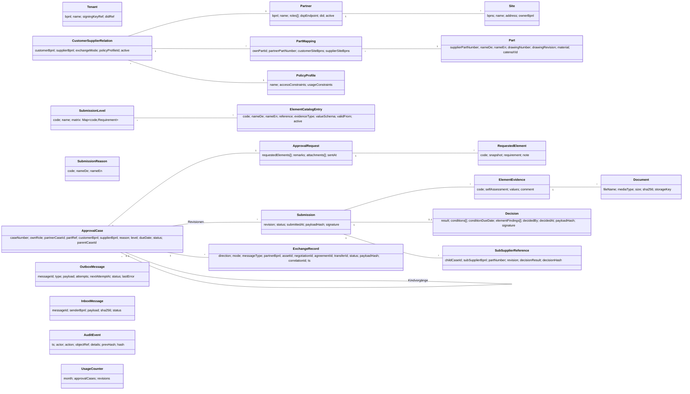
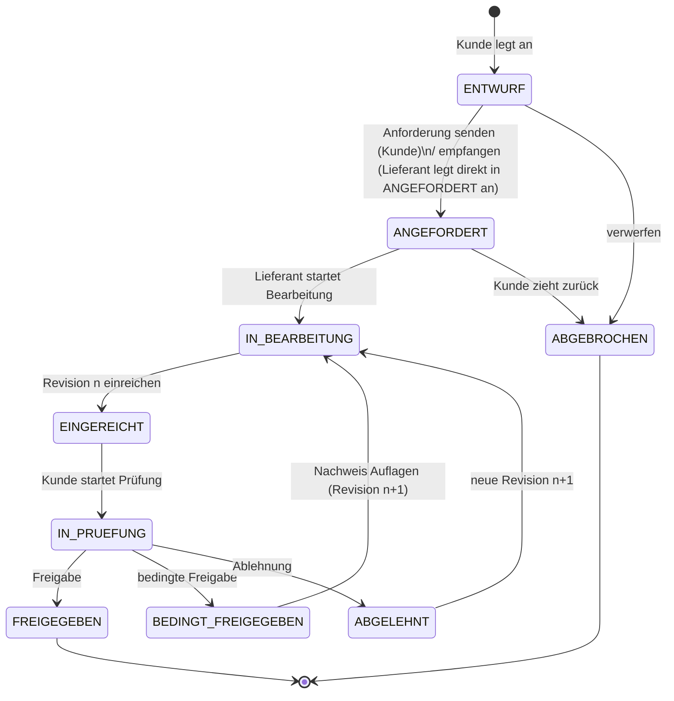

# Fachliches Datenmodell (verfeinert)

Stand: Phase 0. Alle fachlichen Entitäten tragen `tenant_id`, `id` (UUIDv7), `version` (optimistische Sperre), `created_at/by`, `updated_at/by`.

## Klassendiagramm

## Aggregate und Modulzuordnung

| Modul | Aggregate / Entitäten |
|---|---|
| `masterdata` | Partner (+Site), Part, CustomerSupplierRelation (+PartMapping), PolicyProfile, ElementCatalogEntry, SubmissionLevel, SubmissionReason, ExcelTemplate |
| `approval` | **ApprovalCase** (Aggregate Root: ApprovalRequest, Submission, ElementEvidence, Decision, SubSupplierReference) |
| `documents` | Document (Metadaten; Binärdaten im Object Storage) |
| `exchange` | OutboxMessage, InboxMessage, ExchangeRecord, EdrCacheEntry |
| `twin` | TwinRegistration (Shell-ID ↔ ApprovalCase/Revision, Submodel-IDs, Asset-IDs) |
| `semantics` | keine Persistenz; SAMM-Schemas, Mapper, Validierung, Kanonisierung |
| `audit` | AuditEvent (append-only, Hash-Kette je Objekt) |
| `identity` | Tenant, Signaturschlüssel-Referenzen, Benutzerkontext |
| `usage` | UsageCounter |

Module kommunizieren über **Domain Events** (Spring Modulith Event Publication Registry = persistente, transaktionale Events) und über explizite, öffentliche Application-Services (`api`-Package je Modul).

## Zustandsmaschine Freigabevorgang

Die Zustände gelten auf beiden Seiten; jede Seite hält ihren eigenen `ApprovalCase` (Rolle `CUSTOMER` oder `SUPPLIER`), verknüpft über `partnerCaseId`. Übergänge, die vom Partner ausgelöst werden, kommen als Notification.

Ergänzung zum Prompt: `ABGEBROCHEN` (Rückzug einer Anforderung) – minimal, aber ohne ihn können fehlerhafte Anforderungen nie geschlossen werden. Umsetzung als explizite Übergangstabelle (`Map<Status, Set<Transition>>`) mit Guards (Rolle, Vollständigkeit) – kein Framework (Spring Statemachine wäre für 9 Zustände Overkill). Jeder Übergang erzeugt ein Domain Event (`CaseRequested`, `SubmissionSubmitted`, `DecisionMade` …), auf das `exchange`, `audit`, `usage` reagieren.

## Nachrichtentypen (Austausch)

| messageType | Richtung | Inhalt | Auslöser |
|---|---|---|---|
| `PPAP_REQUEST` | Kunde → Lieferant | `PpapRequest` | UC-03 |
| `PPAP_REQUEST_WITHDRAWN` | Kunde → Lieferant | Vorgangs-ID, Grund | Rückzug |
| `PPAP_STATUS_UPDATE` | beide | Status, Zeitpunkt | IN_BEARBEITUNG / IN_PRÜFUNG (A-15) |
| `PPAP_SUBMISSION` | Lieferant → Kunde | `PpapSubmission` (vollständig) | UC-06, Modus PUSH |
| `PPAP_SUBMISSION_AVAILABLE` | Lieferant → Kunde | Twin-ID, Submodel-ID, Revision, Hash | UC-06, Modus PULL-Notify |
| `PPAP_DECISION` | Kunde → Lieferant | `PpapDecision` + JWS | UC-08 |
