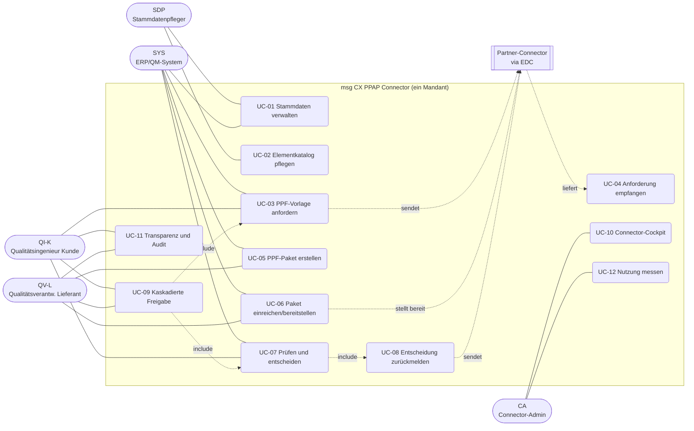

# Use Cases – msg CX PPAP Connector

Stand: Phase 0 (Entwurf zur Freigabe)

## Akteure

| Akteur | Beschreibung |
|---|---|
| **QI-K** – Qualitätsingenieur Kunde | fordert PPF-Vorlagen an, prüft, entscheidet |
| **QV-L** – Qualitätsverantwortlicher Lieferant | bearbeitet Anforderungen, erstellt und reicht PPF-Pakete ein |
| **SDP** – Stammdatenpfleger | pflegt Teile, Partner, Standorte, Beziehungen, Elementkatalog |
| **CA** – Connector-Administrator | EDC-Anbindung, Policies, Partnerverbindungen, Monitoring |
| **SYS** – Systemintegration (technischer Client) | ERP/QM/PLM-Anbindung über REST-API |
| **Partner-Connector** (sekundär) | msg CX PPAP Connector (oder kompatibles System) des Geschäftspartners, erreichbar ausschließlich über dessen EDC |
| **Catena-X Core Services** (sekundär) | Identität (Wallet/DIM bzw. Wallet-Stub), BDRS, Discovery |

Ein Mandant (Teilnehmer, BPNL) ist je nach Beziehung **Kunde** oder **Lieferant** – ein Tier-1 ist beides.

## Übersicht

| ID | Titel | Primärakteur | Phase |
|---|---|---|---|
| [UC-01](UC-01-stammdaten.md) | Stammdaten verwalten | SDP, SYS | 2 |
| [UC-02](UC-02-elementkatalog.md) | Vorlageelement-Katalog pflegen | SDP | 2 |
| [UC-03](UC-03-vorlage-anfordern.md) | PPF-Vorlage anfordern | QI-K | 3/4 |
| [UC-04](UC-04-anforderung-empfangen.md) | Anforderung empfangen | System (QV-L) | 4 |
| [UC-05](UC-05-paket-erstellen.md) | PPF-Paket erstellen | QV-L | 3 |
| [UC-06](UC-06-paket-einreichen.md) | PPF-Paket einreichen und bereitstellen | QV-L | 4/5 |
| [UC-07](UC-07-pruefen-entscheiden.md) | PPF-Paket prüfen und entscheiden | QI-K | 3 |
| [UC-08](UC-08-entscheidung-rueckmelden.md) | Entscheidung zurückmelden | System | 4 |
| [UC-09](UC-09-kaskade.md) | Kaskadierte Freigabe über die Lieferkette | QI-K/QV-L (Tier-1) | 6 |
| [UC-10](UC-10-connector-cockpit.md) | Datenaustausch überwachen (Connector-Cockpit) | CA | 6 |
| [UC-11](UC-11-transparenz-audit.md) | Transparenz und Audit | alle | 6 |
| [UC-12](UC-12-nutzung-messen.md) | Nutzung messen | CA | 6 |

## Use-Case-Diagramm

Quelle (PlantUML): [`../diagrams/use-cases.puml`](../diagrams/use-cases.puml). Die Mermaid-Variante unten wird von GitHub/GitLab direkt gerendert.

## Querschnittliche Akzeptanzkriterien (gelten für alle UCs)

- **AK-X1** Jede schreibende Aktion erzeugt einen `AuditEvent` (Akteur, Zeitpunkt, Mandant, Objekt, Aktion, Korrelations-ID).
- **AK-X2** Jede Aktion, die in der UI möglich ist, ist auch über die REST-API `/api/v1` möglich (API-first), sofern nicht anders vermerkt.
- **AK-X3** Datenaustausch mit Partnern ausschließlich über EDC (DSP); jeder Austauschschritt erzeugt einen `ExchangeRecord`.
- **AK-X4** Rollenprüfung serverseitig; UI blendet nicht erlaubte Aktionen aus.
- **AK-X5** UI zweisprachig (DE Standard, EN), WCAG 2.1 AA.
